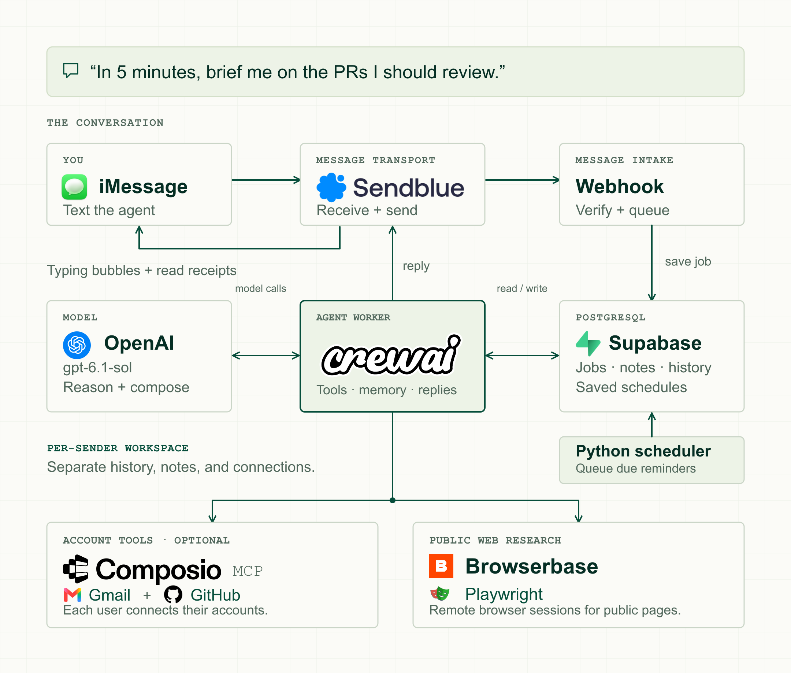

# OpenInstinct — CrewAI edition

Inspired by [Merit Systems’ OpenInstinct](https://github.com/Merit-Systems/OpenInstinct).
This is an independent CrewAI implementation with a different service stack.

A tenant-scoped conversational assistant using CrewAI, Supabase, Sendblue,
Browserbase, and Composio-hosted MCP. The user texts the agent's number; their
first message creates a private workspace without an app signup.

> **Experimental — not intended for production use.** This project is under
> active development. Behavior and APIs may change. It has not been security
> audited or validated for production. The API, worker, scheduler, and public
> tunnel currently run locally.



Sendblue routes incoming texts to a verified webhook, which saves a job in
Supabase. The CrewAI worker uses OpenAI and available tools, then delivers
replies through Sendblue. A Python scheduler queues reminders and briefings
from saved schedules.

[Download PNG](docs/media/linkedin/openinstinct-architecture.png) ·
[Editable SVG](docs/media/linkedin/openinstinct-architecture.svg) ·
[Logo sources](docs/media/linkedin/logo-sources.json)

## Features and current status

| Feature | Current behavior |
| --- | --- |
| Text-first onboarding | One private workspace per sender phone, on one configured service line. |
| Conversation | Answers with recent chat history; up to 20 prior message rows are supplied per turn. |
| Explicit memory | Saves, recalls, and forgets requested notes/preferences. Up to 100 notes are stored; the latest 30 are supplied per turn. |
| Public-page research | Reads supplied public URLs through fresh Browserbase sessions. |
| Read receipts | Marks the conversation read when the worker starts processing. |
| Typing bubbles | Shows the three-dot indicator while preparing a reply; stops on completion or failure. |
| Gmail and GitHub | Tools are enabled through Composio MCP after the sender authorizes their account. |
| Durable processing | Inbound deduplication, queued jobs, fenced leases, and a persisted reply outbox. |
| Tenant isolation | Separate history, notes, and Composio sessions for each workspace. |
| Proactive texts | Durable reminders, recurring URL/Gmail/GitHub PR briefings, page-change alerts, and conditional Gmail followups. |
| Account watches | Signed Composio new-Gmail/ GitHub-commit events after trigger and webhook configuration. |
| Notification controls | List/pause/resume/cancel rules, quiet hours, daily caps, and persisted restart-safe schedules. |

See [proactive features and examples](docs/PROACTIVE.md) and the
[hosted deployment plan](docs/DEPLOYMENT.md). This directory is the repository root;
CI and deployment configuration are included here. See the
[project overview](docs/OVERVIEW.md) for a short introduction. AI coding assistants should start with
[AGENTS.md](AGENTS.md) for service setup, local startup, and verification.

Model upgrade validation: GPT-6.1 Sol passed live CrewAI tool calling, the
application’s structured scheduling parser, notification generation, and PR
briefing formatting using synthetic inputs. These checks did not send messages
or access connected Gmail/GitHub accounts.

Current validation: **96 Python tests**, **five isolated SQL regression suites**,
and **15 backend E2E checks** passed with GPT-6.1 Sol and real Browserbase research.
A genuine five-minute GitHub briefing survived a worker restart and produced one
outbound notification containing two direct review requests. Sendblue reported
**DELIVERED** for both acknowledgment and briefing. The isolated backend tests
capture outgoing messages; they do not send to synthetic phone numbers. Gmail,
new OAuth consent, account writes, and hosted deployment were not exercised live
in this run. See the [E2E report and repeatable commands](docs/E2E_TEST_REPORT_2026-10-07.md).

Not implemented: Calendar/Drive,
attachment analysis, authenticated browser automation, automatic instinct
learning, a password vault, organization memberships, or a web dashboard.
Account watches need `COMPOSIO_WEBHOOK_SECRET` and additional Composio
permissions; implementation alone does not activate subscriptions.

## Conversation flow

Text **+1 (786) 213-9363** from your verified test phone. Try:

- `Remember that I prefer vegetarian meals.`
- `What preference do you remember?`
- `Forget my meal preference.`
- `Read https://example.com and summarize it.`
- `Connect my Gmail.`
- `Connect my GitHub.`

When account consent is needed, the agent replies with a Composio authorization
link. Complete consent in the hosted page, then text `done`. The next turn
restores the same session and verifies connection status. Issuing a link alone
does not establish account access. External-provider consent is separate from
the agent app, which has no signup requirement.

The Sendblue number is the assistant's shared receiving line. Account ownership
comes from the person texting it. Dashboard test connections under another
Composio user are not automatically shared with phone workspaces.

## Local setup

Use Python **3.11–3.13** and `uv`. All commands below run from
the project root unless stated otherwise.

The `crewai-open-instinct/` checkout is the application and repository root.
From the directory containing the checkout:

```sh
cd crewai-open-instinct
```

The Python distribution is `crewai-open-instinct`; its import package is
`crewai_open_instinct` under `src/`.

```sh
uv sync --locked --group dev
uv run preflight
uv run preflight --online
```

`preflight` checks required configuration. Its online mode makes read-only
authentication checks for Supabase, Sendblue, and Browserbase; it does not
send messages, run a model, or validate Composio MCP execution.

For a new environment, copy [.env.example](.env.example) to `.env` and fill in
the variables. Keep existing credentials in place. Exported process variables
override the project `.env`. No parent-directory environment file is loaded.
Archived `.env.local` and `.env.shared.backup` files are not loaded or published.

Restart the worker after changing its credentials or configuration.

### Required services

| Service | Variables | Purpose |
| --- | --- | --- |
| Supabase | `SUPABASE_URL`, `SUPABASE_SECRET_KEY` | Database RPCs for workspaces, history, notes, jobs, and account sessions. |
| Sendblue | `SENDBLUE_API_KEY`, `SENDBLUE_API_SECRET`, `SENDBLUE_PHONE_NUMBER`, `SENDBLUE_WEBHOOK_SECRET` | Messaging, signed inbound webhooks, read receipts, and typing indicators. |
| Browserbase | `BROWSERBASE_API_KEY` | Public-page reading; required by worker preflight. `BROWSERBASE_PROJECT_ID` is optional. |
| Model provider | `OPENAI_API_KEY` by default | Agent reasoning. `LLM_MODEL` defaults to `openai/gpt-6.1-sol`. |

GPT-6 models use CrewAI’s Responses API adapter with low reasoning effort and
`store=False`. Supabase continues to own conversation state. Older OpenAI and
Anthropic overrides retain their existing adapter settings.

The worker also supports `LLM_MODEL=anthropic/<model>` with
`ANTHROPIC_API_KEY`; the corresponding CrewAI optional provider dependencies
may need installation. Text conversations do not require Supabase Auth.
`SUPABASE_PUBLISHABLE_KEY` is only used by retained legacy account APIs.
Attachment storage/analysis is not implemented.

### Database setup

The current pilot schema is already applied. For a new environment, review the
[migrations](supabase/migrations/) and run:

```sh
uv run python scripts/migrate.py
```

The migrator uses `SUPABASE_DATABASE_PASSWORD`. Set
`SUPABASE_DATABASE_HOST` and `SUPABASE_DATABASE_USER` from Supabase's Connect
page when using a session pooler. The current pilot uses the pooler because
the direct host requires IPv6. Runtime RPCs use the secret API key instead of
the database password.

Migrations are repeatable and create separate `ci_*` tables/functions while
preserving other application data. They can also be applied through Supabase
SQL Editor. The migration sequence covers messaging, phone onboarding, and
private Composio identities/sessions.

### Optional Gmail/GitHub integration

Set `COMPOSIO_API_KEY` in the same Composio project as the intended auth
configurations. Create a scoped project key with:

| Permission | Access |
| --- | --- |
| Session management | Read and write |
| Session tool execution | Write only |
| Connected accounts | Optional read only for diagnostics |
| Observability | Optional read only for diagnostics |

Other permission areas are unused by the current integration. Scoped-key
permissions are fixed at creation; replace the key to change its permissions.

Composio manages OAuth consent, credential storage, and token refresh. Custom
OAuth credentials are only needed if the selected auth configuration requires
them. CrewAI consumes the hosted MCP URL and authentication headers; the SDK
creates/restores sessions. There is no local MCP server or CrewAI AMP account
requirement. Core chat remains available when account tools cannot connect.

New workspaces use their UUID as the stable Composio user ID. Session RPCs derive
the workspace from an active job lease, and restored sessions must match their
owner and Gmail/GitHub allowlist. Optional operator mappings support existing
accounts belonging to one workspace. Remote code execution and cross-user
account overrides are rejected. Email sends and GitHub changes require an
explicit request with sufficient details.

## Start the service

Run the API and worker in separate terminals:

```sh
uv run serve
```

```sh
uv run worker
```

Run the scheduler in a third terminal for proactive features:

```sh
uv run scheduler
```

The API defaults to port **8000**. Useful endpoints:

| Endpoint | Purpose |
| --- | --- |
| `/health` | API health check. |
| `/test` | Information page with Open Messages and Copy Number actions. |
| `/docs` | API documentation. |
| `/webhooks/sendblue` | Signed inbound message webhook. |
| `/webhooks/composio` | Signed optional Gmail/GitHub watch events. |

Expose port 8000 through a public HTTPS tunnel or deployment. Register
`<public-base-url>/webhooks/sendblue` as a Sendblue receive webhook with the
same secret as `SENDBLUE_WEBHOOK_SECRET`. Preserve existing registrations.
Update the registration when the tunnel URL changes. The `/test` page is also
available at `<public-base-url>/test` and `http://localhost:8000/test`.

The current pilot uses a shared line with one verified contact. Additional
phones require provider verification/routing. A dedicated line is needed for
the intended public onboarding experience.

For containers, [compose.yaml](compose.yaml) starts the API, worker, and scheduler:

```sh
docker compose up --build
```

All three services load the project `.env`. The
Dockerfile and local `uv` workflow both install from the checked-in lockfile.
See the [deployment plan](docs/DEPLOYMENT.md) for always-running hosted services.

## Testing

```sh
uv run pytest -q
uv run python scripts/check_composio_mcp.py
uv run python scripts/check_runtime.py
```

The offline Python suite covers webhook authentication/routing, conversation
isolation, delivery behavior, account-session scoping, MCP transport ownership,
and read-receipt/typing failures. The Composio check creates a temporary
isolated session, verifies restoration and hosted MCP discovery, then deletes
it. It does not read account content or send messages. Live CrewAI execution
of Gmail/GitHub tool search was verified separately.

Run SQL regression tests **only against an isolated PostgreSQL database** with
Supabase-like `auth.users`, `auth.uid()`, and the `anon`, `authenticated`, and
`service_role` roles. Apply all migrations first; each test rolls back fixtures:

```sh
psql -v ON_ERROR_STOP=1 -f tests/database.sql
psql -v ON_ERROR_STOP=1 -f tests/text_onboarding.sql
psql -v ON_ERROR_STOP=1 -f tests/account_sessions.sql
psql -v ON_ERROR_STOP=1 -f tests/proactive.sql
```

For model-backed backend E2E checks, use a fresh migrated localhost test database:

```sh
TEST_DATABASE_URL=postgresql://127.0.0.1:5432/openinstinct_e2e uv run python scripts/test_database.py
TEST_DATABASE_URL=postgresql://127.0.0.1:5432/openinstinct_e2e uv run python scripts/test_e2e.py --live-model --browser
```

The second command opts into paid model/Browserbase calls, provisions only
synthetic tenants in that isolated database, and captures outgoing messages.
It rejects databases already containing tenant data. See the
[E2E report](docs/E2E_TEST_REPORT_2026-10-07.md) for requirements and live-test limits.

The SQL checks cover legacy accounts, first-text provisioning, duplicate
events, private history/notes, browser-role access denial, and leased account
sessions. Use the conversation examples above for the real-phone test.

## Operations and boundaries

- Signed Sendblue webhooks establish sender identity. Browser clients cannot
  select a phone's private workspace. Group messages and unrelated lines are
  ignored; concurrent first messages from one phone are serialized.
- Memory is explicit saved notes plus recent conversation history. Browser
  sessions are fresh, allow public-page reading, and retain no login state.
  Attachments are not analyzed. Credentials must not be stored in notes.
- One job advances per conversation; other conversations can run concurrently.
  Generation has a five-minute fenced lease and at most three claims after
  abandonment. A generation exception records a failed job.
- The reply is persisted before sending. Sending jobs are not automatically
  retried: a timeout may occur after provider acceptance. `uncertain` or
  crash-abandoned `sending` jobs block later turns until an operator reconciles
  them with Sendblue history. Never blindly resend these jobs. `sent` means
  provider acceptance; device-delivery tracking is not implemented.
- Read receipts and typing indicators use the persisted line and sender.
  Requests have five-second timeouts; failures do not block the reply. Typing
  expires after four minutes even if the worker crashes. Visible signals are
  best effort and depend on the line and messaging service; typing is iMessage
  only, and SMS has no visible read status.
- The phone is the prototype identity. Number reassignment and recovery need
  a lifecycle flow before a public production launch. Legacy authenticated
  phone-link APIs remain available outside the normal text-first journey.

## Code map

| File/directory | Responsibility |
| --- | --- |
| [api.py](src/crewai_open_instinct/api.py) | Webhook verification, routing, and optional account APIs. |
| [main.py](src/crewai_open_instinct/main.py) | Per-turn CrewAI Flow, prompts, memory tools, and agent response. |
| [worker.py](src/crewai_open_instinct/worker.py) | Job processing, conversation signals, and outbound delivery. |
| [providers.py](src/crewai_open_instinct/providers.py) | Supabase and Sendblue HTTP clients. |
| [browser.py](src/crewai_open_instinct/browser.py) | Bounded public-page reading through Browserbase. |
| [integrations.py](src/crewai_open_instinct/integrations.py) | Scoped Composio sessions and MCP configuration. |
| [mcp_compat.py](src/crewai_open_instinct/mcp_compat.py) | CrewAI transport compatibility: same-task context entry/exit with a connection timeout. |
| [supabase/migrations/](supabase/migrations/) | Service schema and privileged RPCs. |
| [tests/](tests/) | Python and isolated SQL regressions. |

Pinned integration dependencies: CrewAI **1.15.23**, Composio **0.25.0**,
its required client **2.0.0rc8**, and MCP **1.28.1**. The MCP compatibility
transport addresses a CrewAI HTTP teardown issue without editing installed
packages; retest it when upgrading the pinned stack.

## References and origin

- [CrewAI Flows](https://docs.crewai.com/en/concepts/flows)
- [Supabase API keys](https://supabase.com/docs/guides/getting-started/api-keys)
- [Sendblue webhooks](https://docs.sendblue.com/getting-started/webhooks/)
- [Sendblue read receipts](https://docs.sendblue.com/api-v2/read-receipts)
- [Sendblue typing indicators](https://docs.sendblue.com/api-v2/typing-indicators)
- [Browserbase Playwright quickstart](https://docs.browserbase.com/welcome/quickstarts/playwright)
- [Composio MCP with CrewAI](https://docs.composio.dev/examples/python-mcp-agents)
- [Composio authentication](https://docs.composio.dev/docs/authentication)
- [Composio key permissions](https://docs.composio.dev/reference/authenticating-to-composio/project-api-key-permissions)

The original design reference was [OpenInstinct](https://github.com/Merit-Systems/OpenInstinct).
Its repository explicitly warns that the application is **not intended for
production use**. This independent implementation remains an unaudited
prototype. The reference checkout is not part of this workspace or a runtime
dependency.
