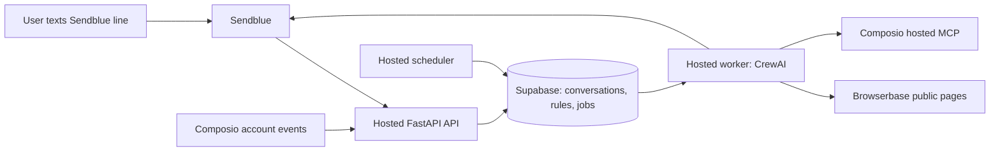

# Hosted deployment plan

Deploy three always-running Docker services on Render, keeping the existing
Supabase project. The API receives signed Sendblue/Composio webhooks, the worker
runs CrewAI and sends messages, and the scheduler dispatches due rules every
30 seconds. Supabase remains the durable source of truth. Browserbase owns
browser sessions and Composio owns account authorization.



This is an engineering pilot, not an audited production service. The original
OpenInstinct project also explicitly warns it is not intended for production.
Hosting improves uptime but does not remove the prototype's limitations.

## Prepared files

- Project-root [render.yaml](../render.yaml): API + worker + scheduler, manual deployments,
  HTTPS API health check, one instance each, graceful worker shutdown.
- [Dockerfile](../Dockerfile): Python 3.11, pinned uv, `uv sync --locked`,
  non-root execution, and ephemeral CrewAI scratch storage.
- [.dockerignore](../.dockerignore): excludes credentials, local runtimes,
  virtual environments, and test artifacts from the build context.
- Project-root [.github/workflows/check.yml](../.github/workflows/check.yml): Python tests, disposable
  PostgreSQL regressions, and a Linux Docker image build before release.
- [Runtime status check](../scripts/check_runtime.py): worker/scheduler
  heartbeats and backlog/uncertain-delivery counts.

Docker builds must still be confirmed on Linux/CI: the current local Docker
daemon was unavailable during implementation. Render's authenticated
Blueprint validation/deployment has not been run. No hosted services have
been provisioned and no cloud billing has been started.

## 1. Put the project in a private Git repository

Use this `crewai-open-instinct/` directory as the Git repository root. Publish its
contents, including `render.yaml` and `.github/workflows/check.yml`. No Git
repository has been initialized yet. Keep `.env`, archived `.env.*` files,
`.runtime/`, and `.venv/` excluded; `.env.example` is safe to publish. The
project `.gitignore` covers these. Verify staged files before pushing.

Run CI and require a passing Docker build. Test CrewAI upgrades separately:
this implementation preserves the tested 1.15.23 pin and its MCP transport
compatibility layer; newer CrewAI releases need a regression run before use.

## 2. Apply the schema to the intended Supabase project

The local pilot uses the existing project. For a separate hosted environment,
provide that project's credentials to the migrator and run from the project root:

```sh
uv sync --locked --group dev
uv run python scripts/migrate.py
```

Migration `0004_proactive.sql` adds schedules/settings/proactive jobs, and
`0005_account_events.sql` adds scoped watch binding/event intake, and
`0006_conversation_bursts.sql` joins immediately following text/link events.
Apply all
migrations in order before deploying updated services. They preserve other
application tables. Keep database backups enabled and verify restore access.

`SUPABASE_DATABASE_PASSWORD`, host, and user are migration/operator settings;
runtime services use `SUPABASE_URL` and `SUPABASE_SECRET_KEY`. The container
omits dev-only psycopg, so use the local/CI migration environment, not the
runtime container, for migrations. There is no persistent Render disk, Redis,
new storage bucket, or Supabase Cron extension required for this design.

## 3. Create the Render Blueprint

Connect the private Git repository in Render and select the root `render.yaml`.
Review billing and validate the Blueprint before creating services. It selects
Oregon; change the region before creation if another is closer to Supabase.

| Service | Initial compute | Start command | Purpose |
| --- | --- | --- | --- |
| API | 0.5 CPU / 512 MB | `serve` | Public HTTPS ingress |
| Worker | 1 CPU / 2 GB | `worker` | Agent/model/browser work |
| Scheduler | 0.5 CPU / 512 MB | `scheduler` | Durable due-job dispatch |

These are paid, always-running services. The worker size is an initial
recommendation; measure memory/latency and resize as needed. Calculate the
current total in Render's creation screen plus Supabase, Sendblue, Browserbase,
Composio, and model usage. Do not rely on an unverified flat monthly estimate.

Render prompts for required `sync: false` secrets on initial creation. Fill
the same existing provider values on API/worker; put Supabase credentials on
all three. Database passwords are not needed on running services.

Optional values to add manually:

| Variable | Services | When needed |
| --- | --- | --- |
| `COMPOSIO_API_KEY` | Worker; API for event intake | Gmail/GitHub account features |
| `COMPOSIO_WEBHOOK_SECRET` | API + worker | Account watches |
| `BROWSERBASE_PROJECT_ID` | Worker | Explicit Browserbase project |
| `SUPABASE_PUBLISHABLE_KEY` | API | Retained legacy Auth APIs only |
| `APP_URL` | API + worker | Record hosted public API base URL |
| `APP_ORIGINS` | API | Exact allowed browser origins, if needed |

If using Anthropic, change `LLM_MODEL`, install the required provider extras,
and supply its key instead of the default OpenAI configuration. Do not copy
the old reference checkout's archived `.env.local` wholesale.

Required external services remain Supabase, Sendblue, Browserbase, and the
model provider. Composio/Gmail/GitHub are optional account integrations.
Render replaces the laptop API/worker/scheduler and ngrok.

## 4. Verify before switching messaging traffic

Use the new Render HTTPS URL to verify `/health` and `/test`. Run
`python scripts/check_runtime.py` from an authenticated operator environment
using the intended Supabase project: worker heartbeat should be under six
minutes old (it can be busy generating), scheduler under two minutes.

Send an unsigned empty request to `/webhooks/sendblue`: expect 401. A signed
empty request should return 400, proving routing/authentication without
creating a fake user or sending a text. Confirm API/worker/scheduler logs have
no repeated errors.

## 5. Cut over Sendblue and account events

Once hosted checks pass, register
`https://<hosted-api>/webhooks/sendblue` as the receive webhook for
`SENDBLUE_PHONE_NUMBER`, using the matching `SENDBLUE_WEBHOOK_SECRET`. Verify
the registration and preserve unrelated account webhooks. Then remove only
this agent's old ngrok registration. Keep the same verified phone and line.

For account watches, register the Composio V3 trigger-event subscription at
`https://<hosted-api>/webhooks/composio` and put its signing secret on the API
and worker. See [watch setup and key permissions](PROACTIVE.md). If local
watches were configured, update that app's destination rather than creating
duplicate subscriptions. This may affect all trigger instances in that
Composio project; preserve other applications' subscriptions.

Stop the local worker and scheduler gracefully as hosted services start.
Fenced leases/deduplication support overlap, but only one intended worker and
scheduler should remain for this pilot. After hosted message verification,
stop the local API and tunnel. Leave Supabase state intact.

## 6. Test persistence from a real phone

1. Text `Remember that I prefer vegetarian meals` and verify the reply.
2. Create a five-minute reminder with your explicit timezone.
3. Restart the hosted worker/scheduler before it is due; verify one reminder.
4. Turn off the laptop; text the agent and verify it replies.
5. Connect your Gmail through the conversation, then create a weekday briefing.
6. When trigger setup is enabled, send a matching/nonmatching test email to
   verify notification filtering and provider delay.
7. Pause/resume/cancel a named automation and verify quiet hours/rate caps.

Provider acceptance is not proof of iMessage device delivery; confirm on the
phone. The current shared Sendblue line still requires verified contacts.
Hosting alone does not enable unrestricted public onboarding; obtain a
provider-supported dedicated line for that use.

## 7. Operate and release

Keep manual deploys initially so schema and service versions move together.
For subsequent changes: CI passes, migrations apply, scheduler/worker/API
deploy from the same commit, heartbeats pass, and a real-phone smoke test
passes. Increase workers only after measuring load and concurrency behavior;
this worker processes one job at a time and a long job can delay other users.

Alert operators on stale heartbeats, old queue entries, failed checks, and
uncertain/crash-abandoned sends. The status script reports the underlying
counts, but alert routing is not implemented. Never blindly retry an uncertain
Sendblue send. Reconcile it against provider history first.

Rollback to the last compatible code image while leaving additive schema
intact. If reverting to a pre-proactive worker, stop the scheduler and
reconcile proactive jobs first: that old worker cannot interpret them. Keep
the old webhook only as a temporary recovery target while its server is live.

Before broader rollout, add retention/deletion policies, phone-reassignment
handling, provider quota/backoff policies, delivery reconciliation, dependency
security review, and operational alerts. Model-generated notification filters
remain probabilistic; strict sender/repository filters should become explicit
structured conditions when precision matters.

## Sources

- [Render background workers](https://render.com/docs/background-workers)
- [Render Blueprint schema and compute plans](https://render.com/docs/blueprint-spec)
- [Render health checks](https://render.com/docs/health-checks)
- [Render pricing](https://render.com/pricing)
- [uv Docker integration](https://docs.astral.sh/uv/guides/integration/docker/)
- [Composio triggers](https://docs.composio.dev/docs/triggers)
- [Sendblue webhook API](https://docs.sendblue.com/api/resources/webhooks)
